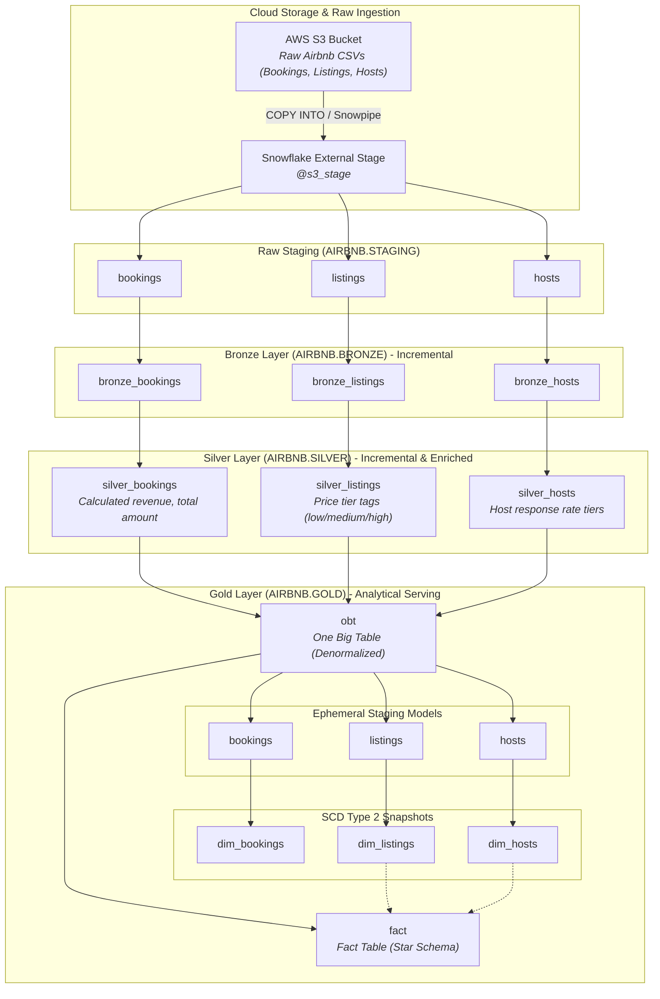

# 🏠 Airbnb Data Transformation Pipeline (AWS S3 + Snowflake + dbt Core)

[](https://aws.amazon.com/s3/)
[](https://www.snowflake.com/)
[](https://www.getdbt.com/)
[](https://www.python.org/)
[](https://github.com/astral-sh/uv)
[-brightgreen?style=for-the-badge)](#-architecture--lineage)

An end-to-end modern analytics engineering pipeline ingesting raw Airbnb hospitality data (listings, bookings, hosts) from **Amazon S3** into **Snowflake**, transforming it through a **Medallion Lakehouse Architecture** into consumption-ready dimensional models and analytical tables using **dbt Core**.

---

## 📌 Executive Summary

This project implements a scalable **Medallion Lakehouse Architecture** on Snowflake. Raw Airbnb data lands in an **AWS S3 bucket**, is staged in Snowflake via external stages, and transitions through Bronze, Silver, and Gold schemas using automated incremental loading, reusable Jinja macros, Slowly Changing Dimensions (SCD Type 2), and dual consumption layers (**One Big Table [OBT]** and **Dimensional Star Schema**).

```
   AWS S3 Bucket (Raw CSV / Parquet Data)
         │
         ▼  (External Stage / COPY INTO)
   Snowflake Staging (AIRBNB.STAGING)
         │
         ▼
 🥉 Bronze Layer       ─── Incremental raw ingestion & watermark filtering
         │
         ▼
 🥈 Silver Layer       ─── Cleansing, feature engineering, business tagging, response tiers
         │
         ▼
 🥇 Gold Layer         ─── One Big Table (OBT), SCD Type 2 Snapshots, Fact & Dimensions
```

---

## 🏛 Architecture & Lineage



---

## 🚀 Key Engineering Highlights

### 1. Cloud Storage Ingestion (AWS S3 $\rightarrow$ Snowflake)
- Raw Airbnb telemetry (bookings, listings, hosts) is stored in an **AWS S3 bucket**.
- Configured with a Snowflake **External Stage** and loaded into the `AIRBNB.STAGING` schema using `COPY INTO` commands, establishing a reliable landing zone before dbt transformations run.

### 2. Medallion Layering & Custom Schema Routing
- Models are segregated into dedicated Snowflake schemas: `BRONZE`, `SILVER`, and `GOLD`.
- Custom macro [generate_schema_name](file:///c:/Users/SREESHANTH_K/Desktop/dbt_snowflake_demo/dbt_snowflake_project/macros/generate_schema_name.sql) ensures consistent target schema routing without unexpected prefixes in development or production.

### 3. High-Performance Incremental Ingestion
- **Bronze Models**: Built using incremental materialization with timestamp watermarking (`WHERE CREATED_AT > (SELECT MAX(CREATED_AT) FROM {{ this }})`) to avoid scanning unmodified historical records.
- **Silver Models**: Incremental merges using primary keys (`BOOKING_ID`, `LISTING_ID`, `HOST_ID`).

### 4. Modular Jinja Macros
- [multiply.sql](file:///c:/Users/SREESHANTH_K/Desktop/dbt_snowflake_demo/dbt_snowflake_project/macros/mutliply.sql): Performs arithmetic operations for revenue metrics (`NIGHTS_BOOKED * BOOKING_AMOUNT`).
- [tags.sql](file:///c:/Users/SREESHANTH_K/Desktop/dbt_snowflake_demo/dbt_snowflake_project/macros/tags.sql): Automatically tags property pricing into tiered buckets (`low`, `medium`, `high`).
- [trimmer.sql](file:///c:/Users/SREESHANTH_K/Desktop/dbt_snowflake_demo/dbt_snowflake_project/macros/trimmer.sql): String hygiene helper standardizing text columns across models.

### 5. Slowly Changing Dimensions (SCD Type 2)
- Implemented dbt snapshots with timestamp strategies (`strategy: timestamp`) across hosts, listings, and bookings.
- Preserves full state changes over time using `dbt_valid_from`, `dbt_valid_to`, and `dbt_scd_id`.

### 6. Dual Serving Layer (OBT & Star Schema)
- **One Big Table (OBT)**: Config-driven Jinja generation dynamically builds a wide reporting view/table, removing join overhead for high-speed dashboarding.
- **Fact & Dimension Models**: Supports traditional dimensional BI tools and queries requiring normalized historical analysis.

---

## 📂 Repository Structure

```text
├── dbt_snowflake_project/             # Main dbt project root
│   ├── analyses/                      # Ad-hoc analysis queries
│   ├── macros/                        # Reusable Jinja macros
│   │   ├── generate_schema_name.sql   # Custom schema management
│   │   ├── mutliply.sql               # Numeric multiplication macro
│   │   ├── tags.sql                   # Pricing tier classification
│   │   └── trimmer.sql                # String cleaning and trimming
│   ├── models/
│   │   ├── sources/
│   │   │   └── sources.yml            # Source definitions for AIRBNB.STAGING
│   │   ├── bronze/                    # Raw ingestion models (incremental)
│   │   │   ├── bronze_bookings.sql
│   │   │   ├── bronze_hosts.sql
│   │   │   ├── bronze_listings.sql
│   │   │   └── properties.yml         # Schema validations & documentation
│   │   ├── silver/                    # Cleansed and business-enriched models
│   │   │   ├── silver_bookings.sql
│   │   │   ├── silver_hosts.sql
│   │   │   └── silver_listings.sql
│   │   └── gold/                      # Analytical marts
│   │       ├── ephemeral/             # Intermediate models for snapshots
│   │       │   ├── bookings.sql
│   │       │   ├── hosts.sql
│   │       │   └── listings.sql
│   │       ├── obt.sql                # One Big Table (OBT) denormalized mart
│   │       └── fact.sql               # Core fact model
│   ├── snapshots/                     # SCD Type 2 dimension snapshots
│   │   ├── dim_bookings.yml
│   │   ├── dim_hosts.yml
│   │   └── dim_listings.yml
│   ├── dbt_project.yml                # Project configurations & model settings
│   └── profiles.yml                   # Connection profiles (Snowflake credentials)
├── pyproject.toml                     # Python dependencies (managed via uv)
├── uv.lock                            # Lockfile for reproducible environments
└── README.md                          # Project documentation
```

---

## 📊 Data Model Catalog

| Layer | Model Name | Materialization | Description |
| :--- | :--- | :--- | :--- |
| **Bronze** | `bronze_bookings` | `incremental` | Incremental ingestion of raw bookings from staging |
| **Bronze** | `bronze_listings` | `incremental` | Incremental ingestion of raw listings from staging |
| **Bronze** | `bronze_hosts` | `incremental` | Incremental ingestion of raw host data from staging |
| **Silver** | `silver_bookings` | `incremental` | Computes `TOTAL_AMOUNT` (nightly charges + cleaning + service fees) |
| **Silver** | `silver_listings` | `incremental` | Enriches listings with calculated price tier tags (`low`, `medium`, `high`) |
| **Silver** | `silver_hosts` | `incremental` | Categorizes host response rates (`high`, `medium`, `fair`, `low`) |
| **Gold** | `obt` | `table` | Config-driven wide denormalized table joining bookings, listings, and hosts |
| **Gold** | `ephemeral.bookings` | `ephemeral` | Ephemeral staging view for booking snapshot pipeline |
| **Gold** | `ephemeral.listings` | `ephemeral` | Ephemeral staging view for listing snapshot pipeline |
| **Gold** | `ephemeral.hosts` | `ephemeral` | Ephemeral staging view for host snapshot pipeline |
| **Gold** | `dim_bookings` | `snapshot` | SCD Type 2 historical tracking of booking records |
| **Gold** | `dim_listings` | `snapshot` | SCD Type 2 historical tracking of property listings |
| **Gold** | `dim_hosts` | `snapshot` | SCD Type 2 historical tracking of host profiles |
| **Gold** | `fact` | `table` | Core star-schema analytical fact model |

---

## 🛠 Getting Started

### 1. Prerequisites
- Python **>= 3.13** installed
- [uv](https://github.com/astral-sh/uv) or `pip`
- An **AWS S3 Bucket** containing raw Airbnb data files (`bookings.csv`, `listings.csv`, `hosts.csv`).
- A **Snowflake** account with a configured database (`AIRBNB`), warehouse (`COMPUTE_WH`), and staging tables.

#### (Optional) Initial S3 Ingestion into Snowflake Staging:
If setting up the staging layer from scratch, create an external stage and load the raw files:
```sql
-- Create an external stage pointing to your AWS S3 bucket
CREATE OR REPLACE STAGE airbnb.staging.s3_stage
  URL = 's3://<your-s3-bucket-name>/airbnb/'
  FILE_FORMAT = (TYPE = 'CSV' SKIP_HEADER = 1 FIELD_OPTIONALLY_ENCLOSED_BY = '"');

-- Load raw data into Snowflake staging tables
COPY INTO airbnb.staging.bookings FROM @airbnb.staging.s3_stage/bookings/ FILE_FORMAT = (TYPE = 'CSV' SKIP_HEADER = 1);
COPY INTO airbnb.staging.listings FROM @airbnb.staging.s3_stage/listings/ FILE_FORMAT = (TYPE = 'CSV' SKIP_HEADER = 1);
COPY INTO airbnb.staging.hosts FROM @airbnb.staging.s3_stage/hosts/ FILE_FORMAT = (TYPE = 'CSV' SKIP_HEADER = 1);
```

### 2. Environment Setup

Clone the repository and install dependencies:

```bash
git clone https://github.com/sreeshanthkprakash-stack/airbnb-dbt-snowflake-pipeline.git
cd airbnb-dbt-snowflake-pipeline

# Create virtual environment and install packages using uv
uv sync
```

Alternatively using standard Python venv:
```bash
python -m venv .venv
source .venv/bin/activate  # On Windows: .venv\Scripts\activate
pip install -r pyproject.toml
```

### 3. Configure Snowflake Connection

Create or update your `dbt_snowflake_project/profiles.yml` (or `~/.dbt/profiles.yml`):

```yaml
dbt_snowflake_project:
  outputs:
    dev:
      type: snowflake
      account: <YOUR_SNOWFLAKE_ACCOUNT>
      user: <YOUR_USERNAME>
      password: <YOUR_PASSWORD>
      role: ACCOUNTADMIN
      database: AIRBNB
      warehouse: COMPUTE_WH
      schema: dbt_schema
      threads: 4
  target: dev
```

### 4. Run the Pipeline

Navigate into the dbt project folder and test connection:
```bash
cd dbt_snowflake_project

# 1. Test Snowflake connectivity
dbt debug

# 2. Run Bronze, Silver, and Gold models
dbt run

# 3. Execute SCD Type 2 Snapshots
dbt snapshot

# 4. Run data quality and schema tests
dbt test
```

To run a specific layer:
```bash
# Run Bronze layer
dbt run --select models/bronze

# Run Silver layer
dbt run --select models/silver

# Run Gold layer
dbt run --select models/gold
```

---

## 🧪 Data Testing & Quality

Schema validations, uniqueness, and nullability checks are configured in [properties.yml](file:///c:/Users/SREESHANTH_K/Desktop/dbt_snowflake_demo/dbt_snowflake_project/models/bronze/properties.yml) to ensure strict upstream data hygiene:

- **Uniqueness tests**: Ensure primary keys (`BOOKING_ID`, `LISTING_ID`, `HOST_ID`) remain distinct.
- **Not-Null tests**: Guard against corrupted or missing identifiers.
- **Snapshot validations**: Ensure validity date ranges (`dbt_valid_from`, `dbt_valid_to`) maintain referential integrity.

---

## 👤 Author

- **Sreeshanth K Prakash** - [GitHub Profile](https://github.com/sreeshanthkprakash-stack)
